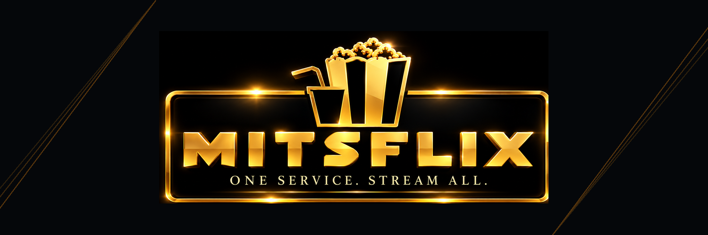

<!-- This README is generated by tools/mitsflix/build_readme.py from README.template.md.
     Edit the template, not README.md: the feature list is refreshed from each OwnTV release. -->
<p align="center">
  
</p>

<h1 align="center">Mitsflix Player</h1>

<p align="center">
  <b>The official Mitsflix player for Android TV, Google TV, Fire TV and Android boxes.</b><br>
  Live TV, movies and series with a full TV guide — fast, modern and built for the remote.
</p>

<p align="center">
  <a href="https://github.com/Mitsflix/MitsflixPlayer/releases/latest/download/MitsflixPlayer.apk"></a>
  <a href="https://github.com/Mitsflix/MitsflixPlayer/releases/latest"></a>
  <a href="https://mitsflix.com"></a>
</p>

---

## 📲 Install

**Downloader app (Fire TV / Android TV):** open Downloader and enter this address. It always installs the newest version:

```
https://github.com/Mitsflix/MitsflixPlayer/releases/latest/download/MitsflixPlayer.apk
```

**Any Android device:** tap the **Download** button above, open the file and allow installs from your browser when asked.

Works on Android 8.0 and newer: Fire TV Stick and Cube, Chromecast with Google TV, NVIDIA Shield, Android TV boxes, projectors, and Android phones and tablets.

## 🍿 Get a playlist

New to Mitsflix? Get your playlist at **[mitsflix.com](https://mitsflix.com)**. The app shows a **Get a playlist** option with a QR code when you set it up, so you can scan it with your phone straight from the TV.

## 🔄 Always up to date

Mitsflix Player checks for new versions and offers to install them for you. Your playlists, favourites and settings stay as they are. New features and fixes arrive regularly.

## ✨ Features

### 🎬 Playback
- **Two engines** — mpv for compatibility, ExoPlayer for instant Live TV, with automatic fallback and a per-channel override
- **4K HDR** direct rendering, optional auto frame-rate matching, surround sound with a stereo safety net, 150% volume boost
- **Subtitles** — text, image and closed captions, plus OpenSubtitles search and local files
- Resume, next-episode auto-play, mini-player/PiP, audio-only mode, live stream-info overlay
- Media-session transport keys and proper audio focus — it behaves like a TV app
- An **error log you can export** for any stream that misbehaves

### 🧭 Browse
- **Home** with Continue Watching and **Now Trending** (TMDB rankings matched to what your provider can actually play)
- Live TV · Movies · Series · Downloads · Guide, with per-profile row order, Favorites, History and search
- **Multiple playlists** at once, with provider labels everywhere they could be confused
- Rename, hide, reorder and combine categories; bulk rename rules
- **TMDB** posters, plots, cast and trailers in 40 languages — scales to ~50k channels / ~168k movies
- **Two layouts for Movies & Series** — the classic three panels, or **Cinematic**: the focused title's artwork full-bleed behind the whole screen, with its details and cast above a wide poster grid
- Adjustable panel widths per section, including hiding the preview pane entirely

### 📥 Sources & EPG
- **Xtream**, **M3U** and **Stalker/Ministra** — add any of them from your phone over Wi-Fi (QR + PIN)
- **TV Guide** (XMLTV) with a live Now marker, multiple guide sources and automatic channel matching
- **Catch-up TV** up to 7 days, live rewind, and *Go back to…* even for channels with no guide
- Guide time offset, per-source guide logos, per-channel EPG fixes
- **Protected (DRM) channels** — Widevine and ClearKey, read from the playlist, nothing to configure
- Custom **DNS** (Google, Cloudflare, Quad9, DoH or your own)

### ⏺️ Recording & Multiview
- Record live TV from the guide, the channel list or while watching — including every showing of a programme
- **Multiview** — up to four channels at once, with one carrying the sound
- Mitsflix Player measures how many streams your provider allows and warns before it refuses one

### 👥 Profiles & Downloads
- Multiple profiles with their own favourites, history and resume points, PIN locks and a Kids mode
- Per-profile startup: Home, last channel, Favorites, or one chosen channel
- Offline movies and episodes with pause, resume, retry and a storage bar

### 🎨 Look & robustness
- Your own accent colour and focus highlight, frosted **Glass** with adjustable opacity, and a Stage,
  Picture or Plain background
- **Dark and Light themes** (or follow the TV) across the whole app, the player included
- Font sizing for the interface and for popups, independently
- **Remote Shortcuts** — map spare colour, number, channel and media keys to 26 actions
- **26 interface languages**, RTL-aware, chosen before anything else on a fresh install
- **Backup & Restore** to a single `.own` file, optionally encrypted, locally or over Wi-Fi
- **Set up from another device** — a new box copies everything from the Mitsflix Player device you already
  have over your own Wi-Fi, offered on the first setup screen rather than buried in the menus
- In-app updates; memory-safe lists, auto-reconnect and offline detection throughout

---

<sub>
Mitsflix Player is a player only: it does not include any channels, playlists or subscriptions.<br>
Based on <a href="https://github.com/ahXN00/OwnTV">OwnTV</a> by ahXN00, free software under the
<a href="LICENSE">GNU GPL v3</a>. Changes: Mitsflix branding, a "Get a playlist" option for mitsflix.com,
and updates published from this repository. The full source code is in this repository.
</sub>
